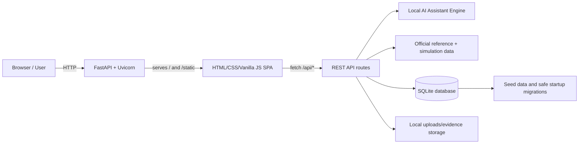

# AAPKE LOG

**AAPKE LOG — Aapke Liye, Hamesha** is a civic-tech prototype for reporting, prioritizing, coordinating, and resolving public issues across Mumbai/BMC wards. It brings housing societies, citizens, municipal departments, universities, industry partners, and city administrators into one workflow.

The application is a single FastAPI service that exposes a REST API, serves a browser-based JavaScript frontend, persists operational data in SQLite, and runs a local rule-based AI/intelligence engine. No Node.js build step is required.

## Key features

- Society-led civic problem reporting with evidence and impact details
- Society reporting without a manually selected priority/severity level
- Clickable **MY PROBLEMS** cards with a complete report-detail modal
- Database-backed affected percentage from unique/legacy votes and society population, with stable non-zero values for original demo records that have no vote rows
- Responsive Gateway hero using the supplied Mumbai skyline, a dark-blue readability overlay, and unchanged navigation actions
- Local JPG/PNG/WEBP evidence upload with preview, change/remove controls, and persistent storage
- AI-assisted category, threat-level, skill, and solver recommendations
- Strict `HIGH → MEDIUM → LOW` prioritization with community voting as a secondary signal
- BMC, university, and industry solver workflows
- Help requests, voluntary help offers, and official team formation
- Dynamic project stages and progress tracking
- Citizen support offers and post-resolution feedback
- Deadline-driven ticket lifecycle: Level 1 (5 days) → Level 2 (10 days) → Level 3 (5 days) → Government/Admin action
- Live Society and BMC workload dashboards derived entirely from SQLite records
- Live Student/University and Industry/Startup participation dashboards
- Separate, persistent Citizen votes and Student/Industry “Vote to Help” records
- Isolated, replayable four-step Hackathon Demo Simulation for judges
- Phone-responsive navigation, dashboards, tables, forms, uploads, modals, and complete Hackathon Demo support
- Ticket-linked progress reports and field-work image evidence for responsible teams
- Admin dashboards, official reference data, and 6,200 generated simulation records
- Interactive API documentation provided automatically by FastAPI

## Tech stack

| Layer | Technology | Purpose |
|---|---|---|
| Backend | Python, FastAPI, Pydantic, python-multipart | REST endpoints, validation, uploads, and business workflows |
| Server | Uvicorn | ASGI development server |
| Database | SQLite | Local persistent application state |
| Frontend | HTML, CSS, vanilla ES modules | Single-page user interface |
| Styling | Tailwind CSS CDN + custom CSS | Utility and application styling |
| Tests | FastAPI `TestClient`, HTTPX, pytest-compatible assertions | End-to-end API workflow checks |

> The AI functionality is implemented locally in `backend/ai_engine.py`; it does not require an external AI API key.

## Responsive behavior

The current desktop layout remains unchanged at widths of 768 px and above. Phone behavior is isolated in the `max-width: 767px` media query in `frontend/css/style.css`.

### Mobile navigation

- The existing desktop role bar and desktop actions remain unchanged on tablets and PCs.
- Phones receive a compact sticky header with the Gateway logo, one-tap Live Hackathon Demo action, and an accessible hamburger/close button.
- The mobile menu shows the active portal and links to Gateway, Society, BMC, University, Industry, Citizen, and Admin.
- Mobile navigation reuses the existing `setView()` system and closes automatically after selection.

### Phone layout and touch behavior

- Page/card padding, large headings, and wide gaps scale down only below the phone breakpoint.
- Dense metric grids collapse where necessary, while long titles, labels, badges, filenames, and buttons wrap safely.
- Images and videos retain their aspect ratio and cannot exceed the viewport.
- Desktop data tables become stacked record cards on phones rather than requiring horizontal scrolling.
- Inputs, selects, textareas, and file controls use the available width and a 16 px mobile font size to avoid iOS input zoom.
- Interactive controls keep touch-friendly heights and retain their original handlers and API behavior.
- Toast notifications use the safe phone width.

### Mobile modals and file uploads

Every existing fixed overlay receives the same phone-only behavior: full available width, `100dvh`-safe maximum height, internal vertical scrolling, hidden horizontal overflow, wrapped actions, and single-column form grids. This covers reporting, details, team formation, BMC Work Alone, feedback, escalation, tickets, attachments, citizen offers, University/Industry contribution forms, and support-review popups.

Image and document inputs retain their existing `accept` restrictions, previews, validation, and FastAPI upload endpoints.

### Mobile Hackathon Demo

The complete judge simulation remains available on phones, including:

1. all four problem selections
2. population and voting controls
3. dynamic affected-percentage calculation
4. all team-formation choices
5. progress visualization
6. solved and ticket outcomes
7. Level 1, Level 2, and Level 3 cards
8. replacement-team formation
9. completion, reset, replay, back, and close controls

The demo remains browser-local and does not modify SQLite.

### Dependencies

No new runtime library, npm dependency, CSS framework, or build step was introduced. Use the existing installation command:

```bash
python -m pip install fastapi "uvicorn[standard]" pydantic python-multipart
```

## Application architecture



### Request and data flow

1. `run.py` starts Uvicorn and imports `backend.main:app`.
2. Importing `backend/main.py` calls `init_db()`, which creates missing tables, applies safe migrations, and seeds demo data.
3. FastAPI serves `frontend/index.html` at `/` and mounts the complete `frontend/` directory at `/static`.
4. `frontend/js/app.js` renders the selected role view and stores UI state in `frontend/js/state.js`.
5. `frontend/js/api.js` sends requests to `/api/*` endpoints. An optional image is uploaded first as multipart form data.
6. The backend validates and stores evidence under `uploads/evidence/`, then returns a public `/uploads/evidence/...` reference.
7. The existing JSON `/api/problems` request stores that reference in `problems.evidence_image`.
8. API handlers apply workflow rules, use `AIAssistantEngine` where needed, and read/write `backend/aapke_log.db`.
9. Updated data is returned as JSON and rendered by the relevant frontend component.

## Project structure

```text
aapke-log/
├── run.py                         # Application launcher (127.0.0.1:8000)
├── test_app.py                    # End-to-end workflow test
├── uploads/
│   ├── evidence/                  # Problem and ticket-creation evidence images
│   └── tickets/
│       ├── reports/               # PDF/DOC/DOCX progress reports
│       └── field-evidence/        # JPG/PNG/WEBP team field-work photos
├── backend/
│   ├── main.py                    # FastAPI app, models, routes, static serving
│   ├── database.py                # SQLite schema, migrations, queries, seeding
│   ├── ai_engine.py               # Local classification and matching engine
│   ├── seed_data.py               # Demo societies, solvers, people, and problems
│   ├── official_reference_data.py # BMC 2024 reference dataset
│   ├── simulation_generator.py    # Synthetic analytics record generator
│   └── aapke_log.db               # Local SQLite database
└── frontend/
    ├── index.html                  # SPA shell and Tailwind CDN setup
    ├── images/
    │   └── mumbai-skyline.png      # Responsive Gateway background image
    ├── css/
    │   └── style.css               # Custom styles and animations
    └── js/
        ├── app.js                  # Rendering, navigation, and event orchestration
        ├── api.js                  # Central `/api` client
        ├── state.js                # Active role, user, modal, and UI state
        ├── demo_controller.js      # Isolated in-memory judge simulation state
        └── components/
            ├── landing.js          # Landing page
            ├── navbar.js           # Role navigation
            ├── society_view.js     # Society dashboard and workflows
            ├── citizen_view.js     # Citizen voting and local issues
            ├── solver_view.js      # BMC/university/industry portal
            ├── admin_view.js       # City administration dashboard
            ├── project_view.js     # Project stages and progress
            ├── ai_inspector.js     # AI recommendation details
            ├── report_modal.js     # Problem reporting flow
            ├── society_problem_detail_modal.js # Complete Society report popup
            ├── team_modal.js       # Official team formation
            ├── feedback_modal.js   # Resolution feedback
            ├── escalation_modal.js # Level 1 Raise a Ticket form and evidence upload
            ├── escalation_ticket_detail_modal.js # Ticket deadline/history popup
            ├── ticket_attachment_modal.js # Solver report/image upload popup
            ├── hackathon_demo_modal.js # Full-screen interactive judge simulation
            └── citizen_offer_modal.js
```

Generated `__pycache__/` directories are runtime artifacts and can be deleted safely.

## Database architecture

SQLite is the application's single source of truth. The schema is created automatically and contains these tables:

- `societies` — registered housing societies, maintained population, and verification state
- `solvers` — BMC, university, and industry organizations
- `students` and `faculty` — university participants
- `problems` — civic reports, AI assessment, status, votes, and progress
- `help_requests` — system-routed requests to solvers
- `help_offers` — voluntary university/industry offers
- `projects` — active project data and dynamic stages
- `teams` — officially formed response teams
- `citizen_support_offers` — voluntary citizen contributions
- `citizen_votes` — one vote per citizen/problem pair
- `support_votes` — separate Student/University and Industry/Startup willingness-to-help votes with one vote per voter/problem
- `feedback` — post-resolution scores and comments
- `escalation_tickets` — levels, real deadlines, evidence, alerts, responsible parties, history, completion reports, and official-action state

The database file is `backend/aapke_log.db`. Keep it out of public repositories if it contains real user data.

## Prerequisites

- Python **3.10 or newer**
- `pip`
- A modern browser with JavaScript enabled
- Internet access on first page load for the Tailwind CSS CDN

No Node.js, npm, frontend package installation, external database, or API key is required.

## Installation

Run all commands from the directory containing `run.py`.

### macOS / Linux

```bash
git clone <repository-url>
cd Aapke-log-main/aapke-log

python3 -m venv .venv
source .venv/bin/activate
python -m pip install --upgrade pip
python -m pip install fastapi "uvicorn[standard]" pydantic python-multipart
```

### Windows PowerShell

```powershell
git clone <repository-url>
cd Aapke-log-main\aapke-log

py -m venv .venv
.\.venv\Scripts\Activate.ps1
python -m pip install --upgrade pip
python -m pip install fastapi "uvicorn[standard]" pydantic python-multipart
```

### Test dependencies

Install these only if you want to run the automated test:

```bash
python -m pip install pytest httpx
```

### Why these packages are installed

- `fastapi` — web framework and `TestClient` integration
- `uvicorn[standard]` — ASGI server and recommended optional runtime extras
- `pydantic` — request body validation used by API models
- `python-multipart` — multipart form parsing required by FastAPI's `UploadFile`
- `httpx` — HTTP transport used by FastAPI's test client
- `pytest` — test discovery and execution

Modules such as `sqlite3`, `json`, `os`, `sys`, `math`, `random`, `re`, `datetime`, and `typing` are part of Python's standard library and must not be installed separately.

## Run the project

With the virtual environment active:

```bash
python run.py
```

Open:

- Application: <http://127.0.0.1:8000>
- Swagger API docs: <http://127.0.0.1:8000/docs>
- ReDoc API docs: <http://127.0.0.1:8000/redoc>

Stop the server with `Ctrl+C`.

### Alternative development command

Use auto-reload while editing backend code:

```bash
python -m uvicorn backend.main:app --host 127.0.0.1 --port 8000 --reload
```

To make the development server reachable from another device on your local network:

```bash
python -m uvicorn backend.main:app --host 0.0.0.0 --port 8000
```

Do not expose this prototype directly to the public internet without authentication, restricted CORS, a production ASGI setup, and proper secret/data handling.

## Role-based demo flow

Use the navigation bar to switch among the built-in demo identities:

1. **Society** reports a problem and reviews help offers.
2. The local **AI engine** classifies the report, assigns a threat level, identifies required skills, and recommends solvers.
3. **BMC / University / Industry** users review requests and offer or accept help.
4. An authorized solver/admin forms an official team.
5. Participants track work through dynamic project stages.
6. **Citizens** view issues from their society, vote, and offer voluntary support.
7. Society representatives or citizens submit resolution feedback.
8. Unresolved work enters at ticket Level 1 and automatically advances only when its stored deadline expires; Admin handles Level 3 expiry or team replacement while preserving completed work.

## Local evidence image upload

The **Society → Report Community Problem** form uses a styled local file picker instead of an image URL field.

### Upload flow

1. The user chooses an optional local image.
2. Browser-side validation checks its MIME type and size.
3. `URL.createObjectURL()` provides an immediate local preview without uploading.
4. The user can change or remove the selected image.
5. On submit, `frontend/js/api.js` sends the file to `POST /api/upload-evidence` as `multipart/form-data`.
6. FastAPI independently validates the filename extension, declared MIME type, binary signature, non-empty content, and size.
7. The backend generates a collision-safe UUID filename and saves the image under `uploads/evidence/`.
8. The endpoint returns a URL such as `/uploads/evidence/7f...c2.png`.
9. The unchanged JSON problem-creation workflow sends that URL in `evidence_image`.
10. SQLite stores only the URL reference; the problem detail page loads the image through the restricted `/uploads` static mount.

### Validation rules

| Rule | Value |
|---|---|
| Allowed formats | JPEG (`.jpg`/`.jpeg`), PNG (`.png`), WEBP (`.webp`) |
| Maximum size | 5 MB |
| Empty files | Rejected |
| MIME/extension mismatch | Rejected |
| Invalid binary signature | Rejected |
| Stored filename | Server-generated UUID plus validated extension |
| Upload directory | `uploads/evidence/` only |
| Image requirement | Optional; reports without a selected image keep working |

Frontend errors appear inline in the report modal. During upload and problem creation, the submit button is disabled to prevent duplicate submissions and the modal displays the current status.

### Evidence upload API

```http
POST /api/upload-evidence
Content-Type: multipart/form-data
```

Multipart field name: `file`

Successful response:

```json
{
  "success": true,
  "image_url": "/uploads/evidence/4b343fd8a5c84d438d89b3db985ead78.png"
}
```

The endpoint may return `413` for an oversized image, `415` for an unsupported or invalid image, `400` for an empty image, and `500` for a storage failure. FastAPI returns `422` when the required multipart field is missing.

## Society Report/Track behavior

### Report form priority removal

The report form no longer contains a manual Priority Level/Severity dropdown. The frontend does not read, validate, store in UI state, or send a priority/severity value. The backend request model retains a safe default so existing API clients and the AI classification pipeline remain backward compatible. Priority and threat analysis remain system-generated rather than society-selected.

### Clickable MY PROBLEMS cards

Each card in **Society → Report/Track → MY PROBLEMS** is keyboard- and mouse-accessible. Selecting a card opens `society_problem_detail_modal.js`, which loads the existing `GET /api/problems/{problem_id}` response and displays:

- complete title and description
- society, ward, and location
- AI category and assessment
- estimated residents impacted
- report date/time, frequency, status, stage, and progress
- unique community voters and affected percentage
- submitted local or legacy evidence images
- an explicit **No evidence image submitted** state
- solver assignment, required skills, and additional notes when available

The existing **View Project Progress**, feedback, and escalation actions remain available and do not trigger the detail modal accidentally.

### Affected-percentage calculation

The Society cards no longer display the problem's threat level. They display:

```text
People Affected = round((unique voters for the problem / society population) × 100)
```

- The numerator is calculated with `COUNT(DISTINCT citizen_id)` from `citizen_votes`.
- The existing unique `(citizen_id, problem_id)` database constraint still enforces one vote per citizen.
- The denominator is read from `societies.population` in SQLite.
- The result is calculated by the backend for every request; no percentage is hardcoded in JavaScript.
- A missing or zero population returns `null`, rendered as `N/A`.
- `GET /api/problems`, `GET /api/problems/{problem_id}`, and the society-scoped citizen endpoint now include `society_population`, `unique_voter_count`, `affected_percentage`, and normalized `evidence_images`.

### Database migration

`init_db()` safely adds the nullable `societies.population` column to existing databases and backfills maintained populations for existing demo societies only when the value is missing or invalid. Existing custom positive population values are preserved. The existing `problems.evidence_image` column remains unchanged.

### Dependencies

This Society update introduces **no new third-party libraries**. Use the same installation command:

```bash
python -m pip install fastapi "uvicorn[standard]" pydantic python-multipart
```

## Raise a Ticket system

### Society workflow

The existing escalation architecture now powers **Society → Report/Track → MY PROBLEMS → Raise a Ticket**.

1. The modal loads the selected problem reference, description, status, and assigned solver.
2. Level 1 is selected by default.
3. Levels 2 and 3 remain visible but disabled; neither can be manually selected.
4. The society describes the stopped/incomplete work and can optionally attach a local evidence image.
5. The image uses the same secure `/api/upload-evidence` workflow as problem evidence.
6. `POST /api/escalations` always creates Level 1 with an actual UTC deadline five days after creation.
7. The ticket appears in Society, Government Officer/Admin, and responsible Solver views.
8. Clicking a Society ticket opens a full details popup with the complaint, photo, current level, status, timestamps, deadline, remaining time, responsible parties, history, and completion report.

Only one active ticket can exist for a problem. Duplicate active submissions return HTTP `409`.

### Automatic lifecycle

```text
Ticket created
    ↓ 5 days
Level 1 — Platform Support Review
    ↓ deadline expires
Level 2 — Senior Solver Review
    ↓ 10 days
Level 3 — Higher Official / Authority Escalation
    ↓ 5 days
Government/Admin Action Required
```

Deadlines are stored as UTC timestamps in SQLite. The processor compares the current time with `current_deadline`; it does not use page timers or hardcoded fake state changes. When processing was delayed beyond multiple deadlines, it advances through every genuinely expired level using the previous deadline as the next level's start time.

Deadline processing runs:

- once when the FastAPI process starts
- when Admin/Solver overview data is requested
- when a problem or ticket detail is requested
- before ticket creation, manual administrative actions, or team responses

This is intentionally compatible with the prototype's single-process architecture and requires no external scheduler. A production deployment may additionally call a scheduled endpoint/job, but normal relevant API activity already performs idempotent checks.

### Alerts and responsible parties

Each ticket-level activation appends internal notification records for:

- the responsible Government Officer resolved from existing BMC solver data
- the currently assigned/recommended solver or team

The existing Admin and Solver screens act as the in-app alert surfaces. They show level, deadline, remaining time, assigned officer, and official-action state. No external email/SMS service or dependency was added.

### Ticket evidence validation

Ticket evidence supports optional JPG/JPEG, PNG, or WEBP files up to 5 MB. Browser validation provides preview/change/remove controls. The backend upload endpoint independently validates size, MIME type, extension, binary signature, UUID filename, and safe storage path. Ticket creation accepts only an existing `/uploads/evidence/...` reference produced by that upload endpoint; arbitrary URLs and filesystem paths are rejected.

### Completion reports

Responsible teams can acknowledge a ticket, submit progress, or submit a completion report. A completion report records its timestamp, changes the status to **Completion Report Submitted - Awaiting Review**, and clears the active deadline so the ticket does not escalate merely because review is pending.

### Safe database migration

Startup adds these nullable/defaulted fields to existing `escalation_tickets` tables:

- `level_started_at`
- `current_deadline`
- `updated_at`
- `responsible_officer`
- `completion_report`
- `completion_reported_at`
- `official_action_required`
- `notifications_json`

Existing ticket content is preserved. Missing deadline metadata is derived from the ticket's stored creation/level timestamp and then evaluated by the same automatic lifecycle processor.

### Dependencies

No new library was introduced for the ticket lifecycle. `python-multipart`, already required by local problem evidence uploads, also handles ticket evidence:

```bash
python -m pip install fastapi "uvicorn[standard]" pydantic python-multipart
```

## Live dashboards and responsible-team evidence

### Society Report/Track dashboard

The Society dashboard calculates all summary cards from the current API/database response:

- total problems reported by the active society
- active/in-progress problems
- resolved problems
- active escalation tickets
- deadline-risk tickets that are overdue or have two days or less remaining
- verified participation, calculated from the sum of real distinct-voter counts returned for the society's problems

No random or presentation-only counts are used. Problem and ticket cards retain their detailed status, affected-percentage, deadline, responsible officer, and remaining-time information.

### BMC Municipal Solver dashboard

The BMC dashboard derives workload metrics from actual problem and escalation records:

- assigned/routed municipal problems
- active projects
- pending work
- completed work
- active tickets
- deadline-crossed tickets

The department accountability cards are generated by an SQLite aggregation joining `escalation_tickets` to `problems`. Total, open, Level 1/2/3, resolved, and average-age values are no longer hardcoded.

**TICKETS RAISED AGAINST RESPONSIBLE TEAM** now contains only tickets whose deadline lifecycle has crossed a level boundary, whose current deadline is expired, or which require official action.

Four actions remain visible. Only these two are enabled:

1. **Submit Progress Update** — direct PDF, DOC, or DOCX upload, maximum 10 MB.
2. **Upload Field Evidence** — direct JPG/JPEG, PNG, or WEBP upload, maximum 5 MB.

**Acknowledge** and **Mark Work Completed** remain visible and disabled as “Coming Soon” for this iteration.

### Corrective BMC team reset and review workflow

- **RESET TEAMS** is directly below **BMC Problem Queue & Official Team Formation**. `POST /api/teams/reset` archives each current team in `problems.previous_teams_json`, clears only current `teams` assignments, and returns affected problems to `Pending Team Formation` with `assigned_solver = "No Team"`. Problems, citizen votes, support votes, escalation tickets, and evidence remain intact.
- Reset problems immediately display **CREATE OFFICIAL TEAM** and **WORK ALONE** again.
- The existing official multidisciplinary form now displays stable demo **Previous Work Rating: ★★★★★ X.X/5** cards for the selected University and Industry partners.
- **WORK ALONE** opens the same form style in `WORK_ALONE` mode, displays the BMC previous-work rating, and creates a one-member BMC Direct Implementation team through the existing `/api/teams` workflow.
- Every card in **TICKETS RAISED AGAINST RESPONSIBLE TEAM** displays its own stable demo previous-work rating; all existing ticket actions are unchanged.

The ratings are deterministic browser-side presentation values between 4.2 and 4.9. They are not written to operational performance records.

### Progress-report validation

The browser validates extension, MIME type, non-empty content, and size before submission. The backend independently validates:

- exact `.pdf`, `.doc`, or `.docx` extension/MIME pairing
- `%PDF-` signature for PDF
- Microsoft OLE compound-document signature for DOC
- valid ZIP structure containing `[Content_Types].xml` and `word/document.xml` for DOCX
- 10 MB maximum size
- generated UUID storage filename and confined destination path

Files are stored in `uploads/tickets/reports/`.

### Field-evidence validation

Field images reuse the established image safeguards:

- JPG/JPEG, PNG, or WEBP only
- MIME/extension pairing and binary image signature
- 5 MB maximum per image
- browser preview, selected filename, replace, and remove controls
- generated UUID filename and confined storage path

Files are stored in `uploads/tickets/field-evidence/`.

### Ticket association and review

`POST /api/escalations/{ticket_id}/attachments` accepts multipart form data with:

- `attachment_type`: `progress_report` or `field_evidence`
- `uploaded_by`: responsible solver/team name
- `file`: selected local file

Attachment metadata is appended to the correct escalation ticket. Uploading evidence does **not** resolve the ticket, reset its deadline, or change its escalation level. Government Officer/Admin and Society users can review downloadable progress reports and actual field-image previews in the existing ticket-details modal.

The safe startup migration adds:

- `progress_reports_json`
- `field_evidence_json`

Both default to empty JSON arrays, preserving existing tickets.

### Dependencies

No new third-party package was required. File validation uses Python's standard-library `io` and `zipfile` modules. Install the existing dependencies:

```bash
python -m pip install fastapi "uvicorn[standard]" pydantic python-multipart
```

## Role-separated voting and help participation

Citizen priority voting and solver willingness-to-help voting are intentionally separate. Neither overwrites or inflates the other.

### Student / University dashboard

The University view uses the active database-backed student identity and live problem/help data to show:

- available relevant community problems
- the active student's Vote to Help count
- total Student/University help votes across relevant problems
- active support projects
- saved student contribution submissions
- problems with Student/University support

University problem cards no longer show **OFFER HELP**. Selecting **Vote to Help** first opens a contribution form asking, “How can you help/contribute to solving this problem?” The required text is saved with the verified student, university, problem, UTC submission time, and `Submitted` status. Only after the API succeeds does the existing green success toast appear.

The BMC department accountability section and supported BMC problem cards display **VIEW UNIVERSITY SUPPORT**. The popup reads the saved SQLite rows and shows the student, university, problem, contribution, date/time, and status.

### Industry / Startups dashboard

The Industry view uses the active verified industry identity and live database data to show:

- available industry-relevant problems
- the active organization's Vote to Help count
- total Industry/Startup help votes
- active support projects
- submitted industry help offers
- problems with Industry/Startup support

Industry problem cards no longer show **OFFER HELP**. They retain **Vote to Help**, which now opens the same contribution-first workflow used by University/Students:

1. The verified Industry/Startup describes how it can contribute.
2. `POST /api/problems/{problem_id}/help-vote` validates the required text and verified Industry identity.
3. SQLite stores the contribution, problem, organization, timestamp, and `Submitted` status.
4. The same unique voter/problem rule prevents duplicate submissions.
5. The backend records an `Unread` notification for the BMC Municipal Solver.
6. Only after success does the frontend show the existing green notification.

The BMC department accountability section shows an **Industry/Startup Support Notifications** panel with its unread count and **VIEW INDUSTRY SUPPORT** controls. The same control also appears on supported BMC problem cards. The popup displays the actual saved Industry/Startup name, problem, contribution, date/time, support status, and BMC notification status.

### Support-vote database model

`support_votes` stores:

- related `problem_id`
- `voter_type`: `StudentUniversity` or `IndustryStartup`
- verified voter ID/name
- verified organization ID/name
- University/Student contribution text
- support status
- BMC notification timestamp and status for Industry/Startup submissions
- UTC vote timestamp

The unique database constraint is:

```text
(voter_type, voter_id, problem_id)
```

This allows multiple distinct students from one university to participate while preventing the same student from voting twice. Each industry/startup ID can likewise vote once per problem.

The backend verifies Student identities against `students` and their University organization, and verifies Industry identities against `solvers` with type `Industry`. Client-supplied display names are not trusted as the authoritative identity.

### Citizen voting

The existing `citizen_votes` table and `/api/problems/{problem_id}/vote` endpoint remain separate. The unique `(citizen_id, problem_id)` rule is preserved, including the existing society-membership restriction. The previously missing browser event handler is now implemented:

- the Vote button disables during submission
- API errors and duplicate votes are shown through existing toasts
- the card count updates immediately from the returned SQLite value
- the Citizen view refreshes and renders the voted state

### Count visibility

Every enriched problem response now includes:

- `community_votes`
- `student_university_help_count`
- `industry_startup_help_count`

Voter-specific University/Industry queries also include `has_help_voted`. The three counts are displayed on:

- Society **MY PROBLEMS** cards
- Society **Show Problem Content → Vote & Support Participation**
- BMC Municipal Solver problem cards
- Student/University and Industry/Startup problem cards

### Voting API

```http
POST /api/problems/{problem_id}/help-vote
Content-Type: application/json
```

Student example:

```json
{
  "voter_type": "StudentUniversity",
  "voter_id": "STU-001",
  "voter_name": "Aarav Sharma",
  "organization_id": "UNI-001",
  "organization_name": "Demo Tech University Mumbai",
  "contribution": "Our civil engineering team can map drainage levels, complete a field survey, and prepare a hydraulic remediation model."
}
```

Industry example:

```json
{
  "voter_type": "IndustryStartup",
  "voter_id": "COM-001",
  "voter_name": "Demo IoT Solutions Pvt Ltd",
  "organization_id": "COM-001",
  "organization_name": "Demo IoT Solutions Pvt Ltd",
  "contribution": "We can deploy IoT sensors, provide field engineers, and maintain a live monitoring dashboard."
}
```

Duplicate votes return HTTP `409`. No new dependencies were added.

## Hackathon Demo Simulation

The top-navigation **Live Hackathon Demo** button no longer starts the legacy guided role-switching bar or invokes live application workflows. It now opens a polished, full-screen judge simulation.

The simulation is entirely in browser memory:

- it does not call FastAPI
- it does not create problems, votes, teams, projects, or tickets
- it does not modify SQLite or uploaded files
- closing or resetting it leaves the active application data untouched

### Step 1 — Submit Problem

Judges choose one of four predefined scenarios:

- dangerous potholes on a school-bus route
- recurring water-main leakage
- garbage accumulation near a residential market
- blocked storm drain and monsoon waterlogging

Selecting a scenario simulates a fully completed report form and advances directly to voting. The selected scenario retains title, description, category, ward, location, and estimated impact for all following steps.

### Step 2 — Voting

The selected scenario is rendered using the Society **MY PROBLEMS** visual language. Judges independently select:

- Society Population: `500`, `700`, or `1000`
- People Voted: `300`, `500`, or `800`

The result is recalculated on every selection:

```text
Affected % = round((People Voted / Society Population) × 100)
```

No result is precomputed or hardcoded.

### Step 3 — BMC Municipal Solver

The simulation presents the same execution modes represented by the actual BMC team workflow:

- `WORK_ALONE` — BMC Direct Implementation
- `UNIVERSITY` — BMC + University Research Team
- `INDUSTRY` — BMC + Industry Delivery Team
- `COMBINED` — Official Multidisciplinary Taskforce

Each option displays its representative municipal, faculty/student, and/or industry roles. Selecting a team advances to progress without calling the real team API.

### Step 4 — View Progress

A Citizen-style visual lifecycle displays simulated progress from Reported through Community Review. Judges can choose:

- **Problem Solved** — finishes with a resolution summary.
- **Ticket Raised** — displays selectable Level 1, Level 2, and Level 3 ticket cards using the application's ticket visual language.

Level 3 reveals **Form Another Team**. That action reopens the simulated BMC formation menu in replacement mode; selecting the replacement team finishes with a continuity/redeployment summary.

### Judge controls

- four-step progress indicator
- subtle transition animation between steps
- Back, Reset, Close, and Replay controls
- final summary of selected problem, dynamic affected percentage, and final team
- visible **Simulation Only** and **No real workspace data was changed** notices

### Dependencies

No dependency or installation change was required. The simulation uses existing Vanilla JS, Tailwind classes, modal infrastructure, and CSS animations:

```bash
python -m pip install fastapi "uvicorn[standard]" pydantic python-multipart
```

## API overview

### Read endpoints

| Method | Endpoint | Purpose |
|---|---|---|
| GET | `/api/reference-data` | Official BMC reference dataset |
| GET | `/api/simulation-data` | Simulation summary |
| GET | `/api/simulation-records` | Filterable generated records |
| GET | `/api/societies` | Societies |
| GET | `/api/solvers` | Solvers, optionally by type |
| GET | `/api/students` | Students, optionally by university |
| GET | `/api/faculty` | Faculty, optionally by university |
| GET | `/api/problems` | Filtered problems plus population, unique-voter, percentage, and evidence metadata |
| GET | `/api/problems/{problem_id}` | Complete problem details plus calculated impact and normalized evidence images |
| GET | `/api/escalations/{ticket_id}` | Process deadlines and return complete enriched ticket details |
| GET | `/api/problems/{problem_id}/help-offers` | Offers for a problem |
| GET | `/api/citizen/my-society-problems` | Society-scoped citizen problem list |
| GET | `/api/admin/overview` | System-wide admin summary |

### Workflow endpoints

| Method | Endpoint | Purpose |
|---|---|---|
| POST | `/api/problems/analyze` | Analyze a draft report |
| POST | `/api/upload-evidence` | Validate and store one local evidence image |
| POST | `/api/problems` | Create a problem |
| POST | `/api/problems/{problem_id}/vote` | Add a citizen vote |
| POST | `/api/problems/{problem_id}/help-vote` | Add one verified Student/University or Industry/Startup Vote to Help |
| GET | `/api/problems/{problem_id}/university-support` | Load persisted University/Student contributions for BMC review |
| GET | `/api/problems/{problem_id}/industry-support` | Load persisted Industry/Startup contributions for BMC review |
| GET | `/api/bmc/industry-support-notifications` | Load the persistent BMC Industry-support notification feed |
| POST | `/api/help-offers` | Submit a solver help offer |
| POST | `/api/help-offers/{offer_id}/action` | Accept/reject an offer |
| POST | `/api/help-requests/{hr_id}/action` | Respond to a routed request |
| POST | `/api/teams` | Form an official team |
| POST | `/api/teams/reset` | Archive and reset all current team assignments for the demo |
| POST | `/api/projects/{problem_id}/update-stage` | Update a dynamic project stage |
| POST | `/api/citizen-offers` | Submit citizen support |
| POST | `/api/feedback` | Submit resolution feedback |
| POST | `/api/escalations` | Create a Level 1 ticket with a real five-day deadline |
| POST | `/api/escalations/{ticket_id}/attachments` | Upload and associate a validated progress report or field image |
| POST | `/api/admin/escalation/{ticket_id}/action` | Resolve or acknowledge official action; manual Level 2/3 is rejected |
| POST | `/api/escalations/{ticket_id}/advance` | Compatibility route with the same automatic-level restrictions |
| POST | `/api/escalations/{ticket_id}/team-response` | Submit acknowledgement, progress, or a completion report |
| POST | `/api/admin/replace-team/{problem_id}` | Replace the assigned team |
| POST | `/api/admin/verify-society/{society_id}` | Verify a society |

Use `/docs` for complete, executable request schemas.

## Run tests

After installing the test dependencies:

```bash
python -m pytest -q
```

You can also execute the workflow script directly:

```bash
python test_app.py
```

## Reset the demo database

Stop the server first. To rebuild from the seed data, back up and remove the SQLite file, then restart:

### macOS / Linux

```bash
cp backend/aapke_log.db backend/aapke_log.db.backup
rm backend/aapke_log.db
python run.py
```

### Windows PowerShell

```powershell
Copy-Item backend\aapke_log.db backend\aapke_log.db.backup
Remove-Item backend\aapke_log.db
python run.py
```

`init_db()` recreates the schema and loads the demo records automatically.

## Troubleshooting

### `ModuleNotFoundError: No module named 'fastapi'`

Activate the virtual environment and install runtime dependencies:

```bash
python -m pip install fastapi "uvicorn[standard]" pydantic python-multipart
```

### Port 8000 is already in use

Run on another port:

```bash
python -m uvicorn backend.main:app --host 127.0.0.1 --port 8001
```

### Styles are missing

Tailwind is loaded from `https://cdn.tailwindcss.com`. Check the browser's internet access or replace the CDN setup with a locally built Tailwind stylesheet for offline/production use.

### Changes or demo records persist after restart

This is expected because SQLite data is persistent. Follow **Reset the demo database** to restore seed data.

### The page loads but API requests fail

Open the app through the FastAPI URL rather than opening `frontend/index.html` directly. The frontend expects same-origin `/api` and `/static` paths.

## Implementation summary

### Files modified

- `frontend/js/components/navbar.js` — preserves the desktop header and adds the phone-only hamburger portal menu, active-portal badge, and mobile Demo action
- `frontend/js/app.js` — adds mobile-menu toggle, close, and navigation handlers that reuse the existing view system
- `frontend/css/style.css` — adds the isolated phone breakpoint for page spacing, grids, stacked tables, media, touch controls, forms, toasts, and every modal family
- `frontend/js/components/hackathon_demo_modal.js` — adds wrapper hooks for full-height phone styling without changing desktop composition or simulation logic
- `README.md` — documents breakpoints, navigation, tables, modals, uploads, Demo coverage, unchanged dependencies, and viewport testing
- `frontend/js/components/solver_view.js` — removes Industry OFFER HELP, routes Industry Vote to Help through the contribution form, and adds Industry support buttons plus the persistent BMC notification panel
- `frontend/js/app.js` — adds the independent Industry contribution/review modal handlers and success/error submission states without changing the University handlers
- `frontend/js/api.js` — adds Industry support-detail and BMC notification-feed clients
- `backend/main.py` — requires Industry contribution text, stores BMC notification metadata, and exposes Industry review and BMC notification endpoints
- `backend/database.py` — safely adds BMC notification timestamp/status fields to `support_votes`
- `README.md` — documents the Industry workflow, endpoints, migration, unchanged dependencies, and verification
- `frontend/js/components/solver_view.js` — visibly adds Reset Teams, BMC University Support controls, University-only removal of Offer Help, contribution-form routing, Work Alone routing, and ticket-card ratings
- `frontend/js/components/team_modal.js` — retains the combined team form, adds University/Industry demo ratings, and adds the functional BMC Direct Implementation form/rating
- `frontend/js/app.js` — handles reset, team modes, contribution submission, success/error states, duplicate responses, and both new modals
- `frontend/js/api.js` — adds checked reset and University-support requests while retaining checked Vote to Help and team creation calls
- `frontend/js/state.js` — documents the extended modal state
- `backend/main.py` — requires Student/University contribution text, persists it, exposes BMC review data, and adds the team-reset endpoint with archived history
- `backend/database.py` — safely migrates `support_votes` with nullable `contribution` and `status` fields
- `README.md` — documents every corrective feature, API/schema changes, unchanged install command, and verification
- `frontend/js/components/landing.js` — places the skyline inside the existing Gateway hero with responsive cover positioning, dark-blue overlays, click-through-safe decoration, and unchanged buttons/navigation
- `backend/main.py` — calculates affected percentage from unique citizen votes or the existing legacy aggregate vote count; the 26 original seeded records receive stable, varied 35–76% fallbacks only when their calculated result would otherwise be 0%
- `README.md` — documents both focused changes, with no new package or database migration required
- `frontend/js/components/report_modal.js` — replaced the URL text input with a styled file picker and removed the manual priority/severity control
- `frontend/js/components/society_view.js` — made MY PROBLEMS cards clickable and replaced their threat badge with the calculated affected percentage
- `frontend/js/components/society_view.js` — also renamed the action to Raise a Ticket and made MY ESCALATION TICKETS cards open complete ticket details
- `frontend/js/components/society_view.js` — displays independent Citizen, Student/University, and Industry/Startup counts on every problem card
- `frontend/js/components/escalation_modal.js` — replaced manual multi-level selection and URL evidence with Level 1-only selection, disabled higher levels, local image preview, validation, and submission status
- `frontend/js/components/admin_view.js` — displays automatic-deadline, remaining-time, official-action, and attached evidence through ticket details
- `frontend/js/components/solver_view.js` — adds real University/Industry participation dashboards, role-specific Vote to Help actions, voted state, and all three counts; BMC cards also show the counts
- `frontend/js/components/escalation_ticket_detail_modal.js` — displays downloadable progress reports and field-image galleries
- `frontend/js/components/society_problem_detail_modal.js` — adds the separated Vote & Support Participation section
- `frontend/js/api.js` — adds checked Citizen vote and Vote to Help clients
- `frontend/js/app.js` — implements immediate Citizen voting and Student/Industry Vote to Help handlers with duplicate-error recovery and view refresh
- `frontend/js/state.js` — adds the active verified Student identity used by the University dashboard
- `frontend/js/demo_controller.js` — completely replaces the legacy live-data guided bar with isolated in-memory simulation state and actions
- `frontend/js/app.js` — routes the navigation button to the full-screen simulation and exposes only simulation-specific actions
- `frontend/js/state.js` — recognizes the new `hackathon-demo` modal
- `frontend/js/components/project_view.js` — displays stored evidence images in problem details
- `backend/main.py` — adds verified role-specific Vote to Help creation, duplicate protection, voter-status annotation, and separate support counts on problem responses
- `backend/database.py` — adds the separate persistent `support_votes` table and uniqueness constraint
- `backend/seed_data.py` — added maintained population values to the existing demo society records
- `backend/ai_engine.py` — corrected the existing undefined variable that blocked the AI analysis portion of problem creation during compatibility testing
- `test_app.py` — aligned legacy stage and escalation expectations with the backend's current enforced contracts
- `README.md` — documented architecture, dependencies, API behavior, validation, storage, testing, and the final workflow

### Files/directories added

- `frontend/js/components/industry_contribution_modal.js` — Industry/Startup contribution form shown before Vote to Help is saved
- `frontend/js/components/industry_support_modal.js` — BMC popup rendering actual persisted Industry/Startup contribution and notification data
- `frontend/js/components/university_contribution_modal.js` — required University/Student contribution form shown before Vote to Help is stored
- `frontend/js/components/university_support_modal.js` — BMC popup rendering actual saved contribution rows
- `frontend/js/components/society_problem_detail_modal.js` — complete Aapke Log-style report popup with evidence gallery and no-image state
- `frontend/js/components/escalation_ticket_detail_modal.js` — complete ticket popup with image, deadline, remaining time, responsible parties, history, and completion report
- `frontend/js/components/ticket_attachment_modal.js` — responsible-team PDF/DOC/DOCX and image upload popup
- `frontend/js/components/hackathon_demo_modal.js` — four-step judge simulation with problem cards, live voting math, BMC team choices, progress, ticket levels, replacement team, completion, reset, and replay
- `uploads/evidence/` — persistent local evidence storage
- `uploads/evidence/.gitkeep` — keeps the initially empty upload directory in source archives
- `uploads/tickets/reports/` — persistent solver progress reports
- `uploads/tickets/field-evidence/` — persistent solver field photographs

### Database changes

The safe startup migration adds `societies.population INTEGER`, extends ticket metadata, creates `support_votes` independently of `citizen_votes`, and adds nullable `support_votes.contribution`, `support_votes.status`, `support_votes.bmc_notified_at`, and `support_votes.bmc_notification_status`. Existing support votes remain valid; new University/Student and Industry/Startup votes require a contribution.

The Hackathon Demo Simulation requires no database or API migration because all simulation state is intentionally temporary and browser-local.

### Verification completed

- Automated Chromium checks passed at **390 × 844** across all seven roles: Gateway, Society, BMC, University, Industry, Citizen, and Admin.
- The same seven roles passed at **1440 × 1000** with the desktop role bar visible and the mobile hamburger hidden.
- Fourteen modal states passed phone overflow checks, including reporting, both team modes, escalation, feedback, Society/ticket details, University/Industry contribution and review, citizen offers, and both ticket-upload types.
- Every tested mobile page and modal reported zero document or element horizontal overflow.
- Image controls retained `accept="image/*"`; progress-report controls retained PDF/DOC/DOCX acceptance.
- Twelve Hackathon Demo states passed at phone width, covering all steps, voting, team selection, progress, Levels 1/2/3, replacement team, completion, reset, and replay.
- Browser QA reported zero actionable JavaScript or console errors.
- All 11 existing end-to-end application tests passed after the responsive changes.
- Industry cards rendered Vote to Help without OFFER HELP; University cards retained their existing contribution workflow unchanged.
- The Industry contribution form rendered the required question, textarea, and Submit Contribution action.
- The exact Industry flow passed: submit contribution → persisted verified organization/problem data → green-success response data → duplicate HTTP `409` → BMC notification feed → Industry support-detail retrieval.
- The BMC department section rendered the unread Industry notification count and VIEW INDUSTRY SUPPORT; supported BMC problem cards rendered the same review action.
- Industry review returned the exact saved organization, contribution, timestamp, support status, and unread BMC notification status.
- A University contribution regression check passed against the unchanged University endpoint and modal behavior.
- The exact BMC flow passed: Reset Teams → No Team → existing formation controls available → combined team creation → reset → BMC Work Alone creation.
- Reset preserved problem, citizen-vote, escalation-ticket, and other unrelated row counts; previous team details were archived.
- Combined and Work Alone forms both rendered the required star rating before submission.
- Every rendered responsible-team ticket card included a rating while existing progress-report and field-evidence actions remained present.
- The exact University flow passed: Vote to Help → contribution form → persisted contribution → success response → duplicate HTTP `409` → BMC support retrieval with the same text, identity, timestamp, and status.
- University cards rendered Vote to Help without OFFER HELP; BMC cards and the department section rendered VIEW UNIVERSITY SUPPORT.
- Python and JavaScript syntax checks passed.
- Valid multipart upload and `/uploads/evidence/...` static retrieval passed.
- Missing, oversized, unsupported, extension-mismatched, and invalid-signature files were rejected.
- Problem creation with an uploaded image passed and preserved the stored reference.
- Problem creation without an image passed.
- Existing AI analysis executed successfully after upload integration.
- Problem creation without a frontend priority/severity field passed.
- Affected percentage was verified with 76 distinct voters against the real stored 8,500-person society population.
- Detail API responses were verified for both empty evidence and uploaded evidence.
- Level 1 creation produced a real five-day UTC deadline and officer/solver alert records.
- Forced expiry of stored test deadlines correctly produced Level 1 → Level 2 (10 days) → Level 3 (5 days) → Government/Admin Action Required.
- Arbitrary ticket evidence URLs and duplicate active tickets were rejected.
- Completion-report submission stopped further automatic escalation while awaiting review.
- Society/Admin/Solver source API data included deadline, remaining-time, responsible-officer, and official-action fields.
- Valid PDF and DOCX progress reports were stored, served, and linked to the correct deadline-crossed ticket.
- Valid PNG field evidence was stored, served, and linked to the same ticket.
- Invalid signatures and oversized images were rejected by the backend.
- Attachment uploads left the ticket's escalation level and unresolved status unchanged.
- Department dashboard totals were verified against a direct SQLite count.
- One Citizen vote persisted, updated immediately, and rejected the duplicate citizen vote.
- Two distinct students from the same university voted successfully; the duplicate student vote was rejected.
- One Industry/Startup vote persisted and its duplicate was rejected.
- Voter-specific `has_help_voted` state and all three counts were verified in Society, BMC, University, Industry, and Citizen source responses.
- University/Industry Vote to Help buttons, real participation metrics, BMC count display, and Society detail participation rendering passed component checks.
- A fresh database created the support-vote table and its unique constraint correctly.
- The simulation controller was verified to import no API client and perform no network/database mutation.
- All four predefined problems, dynamic population/vote combinations, calculated percentages, four BMC team modes, three ticket levels, Level 3 replacement flow, solved flow, reset, back, close, and replay states passed component/controller checks.
- All 11 existing end-to-end workflow checks passed after compatibility fixture alignment.

The native operating-system file explorer should still be checked on the target phone/OS because automated browsers can verify file controls and validation but cannot display the device's native picker. Restart persistence follows directly from filesystem storage, but production deployments must place `uploads/` on a persistent volume.

## Production considerations

This repository is a prototype. Before production deployment, add authentication and authorization, restrict CORS, consider full image decoding/re-encoding and malware scanning, move SQLite to a managed database, place uploads on a backed-up persistent volume, add structured logging and migrations, pin dependency versions, compile Tailwind locally, configure HTTPS/reverse proxying, and run Uvicorn behind a production process manager.
